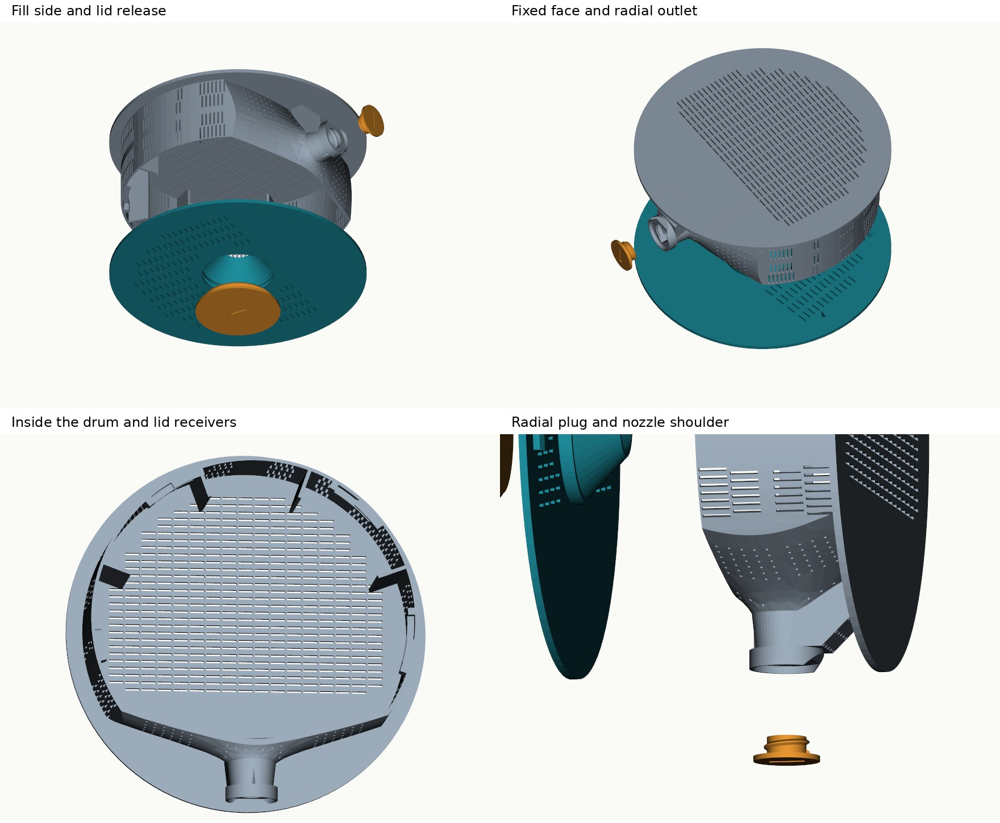

# Preprint review and handoff

## Revision 32 disposition

**Ready for ABS fit coupons.** Both ports now use two-lug bayonets with a 45° clockwise locking turn viewed from outside. The main lid has a 10° lock with an index groove on the drum-facing rim. Align it with the drum's single tick to insert and the double tick to lock. The CAD assembly contains four solids. [Current exploded render](ams-bayonet-review.jpg)

| CAD check | Fill plug | Discharge plug |
| --- | ---: | ---: |
| Maximum entry overlap at 0.25 mm intervals | 0 mm³ | 0 mm³ |
| Fully locked overlap | 0 mm³ | 0 mm³ |
| Peak intentional contact at the detents, sampled every degree | 0.110 mm³ | 0.108 mm³ |
| Interference on 2 mm straight withdrawal while locked | 6.49 mm³ | 6.21 mm³ |

The indexed lid sector also cleared insertion and locking. A 2 mm straight pull in the locked position intersected its shoulder. The drum cleared both the 12 mm side-lip gauge and the 30 mm round-opening gauge. The four straight fins remain a prototype variable pending the pour test.

Bambu Studio sliced all three projects with supports off and no warnings using the X1 Carbon 0.4 mm nozzle and Bambu ABS at 0.20 mm. The production plates total 200.61 g including brims. The optional coupon plate adds 35.89 g. [Drum](../print/ams-ht-drum-abs.3mf) · [Lid and plugs](../print/ams-ht-lid-and-plugs-abs.3mf) · [Fit coupons](../print/ams-ht-fit-coupons-abs.3mf)

### Remaining physical checks

1. Print the coupon plate. Insert, turn, pull and release each plug and the lid sector. Repeat after a drying-temperature cycle. Check by hand that the detents resist incidental turning, the lugs stay intact, and the closures reopen.
2. Check the discharge coupon against the actual container. With the complete assembly, open the fill plug several times and confirm its release torque does not unlock the main lid. Both turn counterclockwise to open. On the first full drum, check lid alignment, roller runout, warm rotation, bead retention and spillage with the smallest beads intended for use.
3. Weigh a partial load before and after pouring. Inspect the fin roots and nozzle for leftovers. Consider shallower ribs only if the pour test warrants it. Record drying performance independently.

## Historical review of revision 28

**Hold the full print for a thread-entry correction.** Revision 28 is a good candidate for small ABS fit coupons. The drum and lid architecture is worth keeping. Review performed on the meshes used for the two current Bambu projects. The CAD and print projects were left as reviewed. [STEVE assembly](https://stevecad.studio/?document=f5b3f84b-33ae-484c-a498-2e649abe1053)

## Exploded inspection

Gray is the drum, teal is the lid, and amber is the two plugs. The lid and plugs are displaced along their removal axes. The lower-left view hides the removable parts to expose the collector.

| View | Finding | Disposition |
| --- | --- | --- |
| Fill side | The central funnel is easy to reach. The plug has a coarse thread and a shallow coin slot. The flat lid has few visual cues for aligning its four lugs. | Correct plug entry first. Add shallow index marks at insert and lock positions if a first-time user cannot locate them readily. Keep marks off the roller tracks. |
| Fixed face | The slotted face has a continuous perimeter for the rollers. Both axial and circumferential air paths are visible. Flatness matters because the removable lid is itself one roller rim. | Preserve the rim. Check wobble and retention with a partial bead load and after a drying cycle. |
| Drum interior | Four continuous fins occupy the upper wall when the outlet is down. The collector has a clear route to the throat. The fins have square edges and project substantially into the bed. | Treat shallower ribs as an optional handling improvement. Measure retained beads after a pour before changing the slicing-verified design. If beads hang up, try 6–8 mm rounded ribs, continuous through the old seam. |
| Outlet | The straight lip stands proud of the sloped underside. A recessed plug closes the port. The fixed roller rim extends past the spout and may contact a real container shoulder. | Keep the integral spout. Test the actual container mouth with both roller rims represented. The existing 30 mm ID gauge establishes 7.3 mm nominal insertion for that gauge shape only. |

## Required change before manufacturing

**Give the two female threads an accessible helical entry.** Their single-start grooves begin partway inside the collars and have finite swept ends. A seated collision check misses the interference on the way in. In a local CadQuery check using the printed fill-plug source and its collar profile, the overlap was zero when seated, 47.2 mm³ at 1 mm withdrawal, 71.2 mm³ at 2 mm and 72.0 mm³ at 4 mm. Withdrawal included the corresponding rotation of 90°/mm for the 4 mm pitch. A separate simplified outlet-collar check with the discharge plug also showed intermediate interference. Verify that port on the complete drum, including its peaked bore and recessed lip.

1. Extend the female helical cutter outward past the entrance, following the same helix and phase. Add a printable lead-in and ease the male leading crest as needed. Keep the flange stop, roller clearance, bead path and plug head accessible.
2. Sweep each actual plug through the complete insertion and removal path against the complete mating body. As a practical regression check, sample at most 0.1 mm axial travel per step with the matching screw rotation. Require zero positive-volume interference above the CAD kernel's numerical tolerance at every pose. Check seating and verify that the discharge plug clears the locating lip.
3. Print both port-and-plug coupons in the final part orientations. Preserve the radial port's horizontal thread and peaked bore in its coupon. Verify that both start by hand, seat, and reopen after an ABS heat cycle.

## Before releasing the two plates

- **Lid retention.** The bayonet uses four lugs, 10° rotation, retaining shoulders and side detents. Check a full-size sector coupon for entry, twist, positive retention and release. Confirm with a loaded prototype that the lid stays locked while rotating warm.
- **Bead handling.** Check the 1.2 mm vents against the smallest actual beads and fragments. Pour a weighed partial load into the intended container and record spills and residual mass. Inspect the fins, thread roots and collector for trapped beads. Drying rate and bead retention have not been measured.
- **Slicer regression.** Revision 28 measures 200 × 200 × 62 mm. Its drum and small-parts plates sliced with supports off and no warnings, at about 200.9 g ABS including brims. After the thread fix, rebuild the four-component assembly, repeat the lip-gauge and roller-envelope checks, and reslice with the same 0.4 mm nozzle, 0.20 mm layers and ABS profile. Update both print projects if both mating interfaces change. [Drum plate](../print/ams-ht-drum-abs.3mf) · [Lid and plugs plate](../print/ams-ht-lid-and-plugs-abs.3mf)

## Revision 34 finger grips

The fill plug has a 6 mm pinch web between two 5 mm deep pockets, 0.55 mm nominal radial shaft clearance, and a lighter detent. The outlet has two open sides in the recess so fingers can reach behind the plug flange. Both plugs can be pulled axially after unlocking. The modeled envelope is 200 mm diameter by 67 mm wide.

The sampled insertion and locked positions clear in CAD. Both retaining shoulders block straight withdrawal when locked. The 12 mm side gauge and 30 mm opening gauge still clear. Bambu Studio sliced both production plates and the coupon plate with supports off and no warnings. The two production plates total 203.84 g including brims. The coupon plate uses 39.11 g. Gloveless grip, release force, and hot retention remain physical coupon checks.

## Revision 35 lower fill grip

The fill grip projects 3 mm past the original plug face, giving a nominal overall spool width of 65 mm. Its 6 mm pinch web sits between two 11 mm wide, 4.2 mm deep finger pockets. Bambu Studio sliced the updated lid and plugs and coupon plates without warnings or supports. Check actual side clearance and spin the empty spool by hand in the AMS-HT before testing a heated load.
